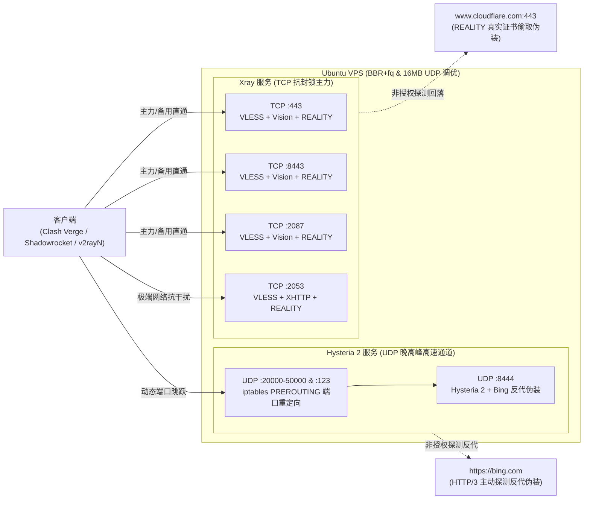

# VPS 双栈协议高可用部署指南（Xray REALITY 多端口 + Hysteria 2 端口跳跃）

本文档整理自生产环境稳定运行的 VPS 标准配置方案。按本指南操作，可在任意一台全新 Ubuntu VPS 上 **1:1 完整复刻相同的内核优化、多协议冗余架构、防封锁伪装与自动自检能力**。

---

## 一、 方案架构与设计思路

本方案采用 **「TCP 强伪装多端口冗余 + UDP QUIC 暴力加速与端口跳跃」** 双协议栈架构，兼顾日常极致稳定性与晚高峰/弱网环境下的高吞吐表现：



### 核心特性一览

| 模块 | 配置内容 | 作用说明 |
| :--- | :--- | :--- |
| **系统与内核** | `BBR + fq` + `16MB UDP Buffer` | 降低跨国 TCP 延迟，解除 Linux 默认 212KB UDP 缓冲区对 QUIC 的限速瓶颈 |
| **Xray 主力通道** | `TCP 443 / 8443 / 2087`<br/>`VLESS + Vision + REALITY` | 无需购买域名与证书，伪装为 `www.cloudflare.com`；三端口互备防止单端口临时阻断 |
| **Xray 抗审查通道** | `TCP 2053`<br/>`VLESS + XHTTP + REALITY` | 采用新一代 SplitHTTP（`xhttp`）传输层，切分流量特征，应对严格长连接干扰 |
| **Hysteria 2 加速** | `UDP 8444`（监听）<br/>`UDP 20000-50000 & 123`（跳跃映射） | 基于定制 QUIC 协议，弱网/晚高峰跑满带宽；配合动态端口跳跃规避运营商 UDP QoS 限速 |
| **内存与连接保活** | QUIC `8MB/20MB` 窗口 + `4s` 心跳 | 专门适配 `1C1G` 小内存机型防止 OOM，同时高频保活防止 NAT 映射老化断流 |

---

## 二、 准备工作

### 1. 服务器选购建议
- **操作系统**：推荐 **Ubuntu 24.04 LTS**（Ubuntu 22.04 LTS / Debian 12 同样完全兼容）。
- **硬件配置**：最低 `1 vCPU / 1 GB RAM / 20 GB SSD` 即可流畅运行。
- **线路建议**：优先选择三网大陆回程优化线路（如美西 `AS4837` / `AS9929` / `CN2 GIA`，若需解锁流媒体或 AI 服务可选双 ISP 原生住宅 IP）。
- **防火墙/安全组**：如果云厂商后台面板带有「安全组 / 云防火墙」，请提前放行以下端口（若无面板防火墙可忽略）：
  - **TCP**：SSH 端口（默认 `22` 或厂商分配的随机端口）、`443`、`8443`、`2087`、`2053`
  - **UDP**：`8444`、`123`、`20000-50000`

### 2. SSH 登录服务器
在本地终端（Windows PowerShell / macOS 终端）执行以下命令登录 VPS（请将 `<SSH端口>` 和 `<VPS_IP>` 替换为你自己的实例信息）：

```bash
ssh -p <SSH端口> root@<VPS_IP>
```

> [!IMPORTANT]
> **安全原则**：每台服务器都应当生成各自独立的 UUID、REALITY 密钥对和 Hysteria 2 密码。下文的分步教程与一键脚本都会在你的服务器上自动生成全新随机凭证，无需手动编造。

---

## 三、 方式 A：全自动一键复刻脚本（推荐新手）

如果你希望在全新 Ubuntu 服务器上 **一次性自动配齐全部环境并直接输出客户端节点链接**，登录 SSH（`root` 用户）后直接复制运行以下整段命令即可：

```bash
cat > /root/setup_dual_stack.sh <<'EOF'
#!/usr/bin/env bash
set -euo pipefail

echo "=== [1/7] 安装基础依赖工具 ==="
export DEBIAN_FRONTEND=noninteractive
apt-get update -y
apt-get install -y curl openssl python3 iptables ca-certificates

echo "=== [2/7] 配置内核 BBR 与 Hysteria2 UDP 缓冲区调优 ==="
cat > /etc/sysctl.d/99-bbr.conf <<'SYS1'
net.core.default_qdisc = fq
net.ipv4.tcp_congestion_control = bbr
SYS1

cat > /etc/sysctl.d/99-hysteria2-udp.conf <<'SYS2'
# Hysteria2 / QUIC UDP buffer tuning (16 MB max, 4 MB default)
net.core.rmem_max = 16777216
net.core.wmem_max = 16777216
net.core.rmem_default = 4194304
net.core.wmem_default = 4194304
net.core.optmem_max = 65536
net.ipv4.udp_rmem_min = 16384
net.ipv4.udp_wmem_min = 16384
net.ipv4.udp_mem = 65536 131072 262144
SYS2

sysctl --system >/dev/null

echo "=== [3/7] 安装并配置 Xray (VLESS + REALITY 四端口) ==="
bash -c "$(curl -fsSL https://github.com/XTLS/Xray-install/raw/main/install-release.sh)" @ install

XRAY_BIN="/usr/local/bin/xray"
UUID=$($XRAY_BIN uuid)
SID=$(openssl rand -hex 8)
KEY_OUT=$($XRAY_BIN x25519)
PRIV_KEY=$(echo "$KEY_OUT" | awk -F': *' '/Private/{print $2}' | tr -d ' \r')
PUB_KEY=$(echo "$KEY_OUT" | awk -F': *' '/Password|Public/{print $2}' | head -n1 | tr -d ' \r')
SNI="www.cloudflare.com"

mkdir -p /usr/local/etc/xray
cat > /usr/local/etc/xray/config.json <<JSON
{
  "log": {
    "loglevel": "warning"
  },
  "inbounds": [
    {
      "listen": "0.0.0.0",
      "port": 8443,
      "protocol": "vless",
      "settings": {
        "clients": [
          {
            "id": "${UUID}",
            "flow": "xtls-rprx-vision"
          }
        ],
        "decryption": "none"
      },
      "streamSettings": {
        "network": "tcp",
        "security": "reality",
        "realitySettings": {
          "show": false,
          "dest": "${SNI}:443",
          "xver": 0,
          "serverNames": [
            "${SNI}"
          ],
          "privateKey": "${PRIV_KEY}",
          "shortIds": [
            "${SID}"
          ]
        }
      },
      "sniffing": {
        "enabled": true,
        "destOverride": ["http", "tls", "quic"]
      }
    },
    {
      "listen": "0.0.0.0",
      "port": 2087,
      "protocol": "vless",
      "settings": {
        "clients": [
          {
            "id": "${UUID}",
            "flow": "xtls-rprx-vision"
          }
        ],
        "decryption": "none"
      },
      "streamSettings": {
        "network": "tcp",
        "security": "reality",
        "realitySettings": {
          "show": false,
          "dest": "${SNI}:443",
          "xver": 0,
          "serverNames": [
            "${SNI}"
          ],
          "privateKey": "${PRIV_KEY}",
          "shortIds": [
            "${SID}"
          ]
        }
      },
      "sniffing": {
        "enabled": true,
        "destOverride": ["http", "tls", "quic"]
      }
    },
    {
      "listen": "0.0.0.0",
      "port": 443,
      "protocol": "vless",
      "settings": {
        "clients": [
          {
            "id": "${UUID}",
            "flow": "xtls-rprx-vision"
          }
        ],
        "decryption": "none"
      },
      "streamSettings": {
        "network": "tcp",
        "security": "reality",
        "realitySettings": {
          "show": false,
          "dest": "${SNI}:443",
          "xver": 0,
          "serverNames": [
            "${SNI}"
          ],
          "privateKey": "${PRIV_KEY}",
          "shortIds": [
            "${SID}"
          ]
        }
      },
      "sniffing": {
        "enabled": true,
        "destOverride": ["http", "tls", "quic"]
      }
    },
    {
      "listen": "0.0.0.0",
      "port": 2053,
      "protocol": "vless",
      "settings": {
        "clients": [
          {
            "id": "${UUID}"
          }
        ],
        "decryption": "none"
      },
      "streamSettings": {
        "network": "xhttp",
        "xhttpSettings": {
          "path": "/xhttp",
          "mode": "auto"
        },
        "security": "reality",
        "realitySettings": {
          "show": false,
          "dest": "${SNI}:443",
          "xver": 0,
          "serverNames": [
            "${SNI}"
          ],
          "privateKey": "${PRIV_KEY}",
          "shortIds": [
            "${SID}"
          ]
        }
      },
      "sniffing": {
        "enabled": true,
        "destOverride": ["http", "tls", "quic"]
      }
    }
  ],
  "outbounds": [
    {
      "protocol": "freedom",
      "tag": "direct"
    },
    {
      "protocol": "blackhole",
      "tag": "block"
    }
  ]
}
JSON

systemctl enable --now xray
systemctl restart xray

echo "=== [4/7] 安装并配置 Hysteria 2 ==="
bash <(curl -fsSL https://get.hy2.sh/)

mkdir -p /etc/hysteria
openssl req -x509 -nodes -newkey ec:<(openssl ecparam -name prime256v1) \
  -keyout /etc/hysteria/server.key \
  -out /etc/hysteria/server.crt \
  -subj "/CN=bing.com" -days 36500 2>/dev/null

chown hysteria:hysteria /etc/hysteria/server.key /etc/hysteria/server.crt
chmod 600 /etc/hysteria/server.key
chmod 644 /etc/hysteria/server.crt

HY2_PASS=$(openssl rand -base64 18 | tr -dc 'A-Za-z0-9')

cat > /etc/hysteria/config.yaml <<YAML
listen: :8444

tls:
  cert: /etc/hysteria/server.crt
  key: /etc/hysteria/server.key

auth:
  type: password
  password: ${HY2_PASS}

quic:
  initStreamReceiveWindow: 8388608
  maxStreamReceiveWindow: 8388608
  initConnReceiveWindow: 20971520
  maxConnReceiveWindow: 20971520
  maxIdleTimeout: 60s
  keepAlivePeriod: 4s

bandwidth:
  up: 50 mbps
  down: 100 mbps

masquerade:
  type: proxy
  proxy:
    url: https://bing.com
    rewriteHost: true
YAML

chown hysteria:hysteria /etc/hysteria/config.yaml
systemctl enable --now hysteria-server.service
systemctl restart hysteria-server.service

echo "=== [5/7] 配置 Hysteria 2 端口跳跃服务 (UDP 123 & 20000:50000 -> 8444) ==="
NIC=$(ip -4 route show default | awk '{for(i=1;i<=NF;i++) if($i=="dev") {print $(i+1); exit}}')

cat > /etc/systemd/system/hysteria-port-hop.service <<HOP
[Unit]
Description=Hysteria2 UDP Port Redirect (123 & 20000:50000 -> 8444)
After=network-online.target
Wants=network-online.target

[Service]
Type=oneshot
RemainAfterExit=yes
ExecStart=/bin/sh -c '/usr/sbin/iptables -t nat -C PREROUTING -i ${NIC} -p udp --dport 123 -j REDIRECT --to-ports 8444 2>/dev/null || /usr/sbin/iptables -t nat -I PREROUTING 1 -i ${NIC} -p udp --dport 123 -j REDIRECT --to-ports 8444; /usr/sbin/iptables -t nat -C PREROUTING -i ${NIC} -p udp --dport 20000:50000 -j REDIRECT --to-ports 8444 2>/dev/null || /usr/sbin/iptables -t nat -A PREROUTING -i ${NIC} -p udp --dport 20000:50000 -j REDIRECT --to-ports 8444'
ExecStop=/bin/sh -c '/usr/sbin/iptables -t nat -D PREROUTING -i ${NIC} -p udp --dport 123 -j REDIRECT --to-ports 8444 2>/dev/null || true; /usr/sbin/iptables -t nat -D PREROUTING -i ${NIC} -p udp --dport 20000:50000 -j REDIRECT --to-ports 8444 2>/dev/null || true'

[Install]
WantedBy=multi-user.target
HOP

systemctl daemon-reload
systemctl enable --now hysteria-port-hop.service

# 若系统启用了 UFW 防火墙，同步放行对应端口
if command -v ufw >/dev/null 2>&1 && ufw status | grep -q "Status: active"; then
  ufw allow 443,8443,2087,2053/tcp
  ufw allow 8444,123/udp
  ufw allow 20000:50000/udp
fi

echo "=== [6/7] 写入本机隧道健康自检脚本 (/root/verify_tunnel.sh) ==="
cat > /root/verify_tunnel.sh <<'VERIFY'
#!/usr/bin/env bash
set -uo pipefail
X=/usr/local/bin/xray
CFG=/usr/local/etc/xray/config.json
PORT=10899

UUID=$(python3 -c "import json;print(json.load(open('$CFG'))['inbounds'][0]['settings']['clients'][0]['id'])")
SID=$(python3 -c "import json;print(json.load(open('$CFG'))['inbounds'][0]['streamSettings']['realitySettings']['shortIds'][0])")
PRIV=$(python3 -c "import json;print(json.load(open('$CFG'))['inbounds'][0]['streamSettings']['realitySettings']['privateKey'])")
SNI=$(python3 -c "import json;print(json.load(open('$CFG'))['inbounds'][0]['streamSettings']['realitySettings']['serverNames'][0])")
LPORT=$(python3 -c "import json;print(json.load(open('$CFG'))['inbounds'][0]['port'])")
PUB=$($X x25519 -i "$PRIV" | awk -F': *' '/Password|Public/{print $2}' | head -n1 | tr -d ' \r')
IP=$(curl -fsS4 --max-time 10 https://api.ipify.org || echo 127.0.0.1)

echo "xray    : $(systemctl is-active xray)  |  hysteria2: $(systemctl is-active hysteria-server)"
echo "endpoint: ${IP}:${LPORT}   sni=${SNI}   sid=${SID}"
echo

cat > /tmp/vt.json <<JSON
{ "log": { "loglevel": "warning" },
  "inbounds": [ { "listen": "127.0.0.1", "port": $PORT, "protocol": "socks",
                  "settings": { "auth": "noauth", "udp": true } } ],
  "outbounds": [ { "protocol": "vless",
    "settings": { "vnext": [ { "address": "127.0.0.1", "port": $LPORT,
      "users": [ { "id": "${UUID}", "encryption": "none", "flow": "xtls-rprx-vision" } ] } ] },
    "streamSettings": { "network": "tcp", "security": "reality",
      "realitySettings": { "serverName": "${SNI}", "fingerprint": "chrome",
        "publicKey": "${PUB}", "shortId": "${SID}" } } } ] }
JSON

nohup $X run -c /tmp/vt.json > /tmp/vt.log 2>&1 & CP=$!
sleep 3
P="socks5h://127.0.0.1:$PORT"
pass=0; fail=0
for t in www.google.com www.youtube.com github.com; do
  printf "  %-18s " "$t"
  if curl -fsS --max-time 25 -x $P -o /dev/null -w "OK  HTTP %{http_code}  %{time_total}s\n" "https://$t" 2>/dev/null; then
    pass=$((pass+1))
  else echo "FAIL"; fail=$((fail+1)); fi
done
kill $CP 2>/dev/null; wait $CP 2>/dev/null; rm -f /tmp/vt.json /tmp/vt.log
echo
if [ "$fail" -eq 0 ]; then echo "RESULT: tunnel healthy ($pass/$pass)"; else echo "RESULT: $fail FAILED"; fi
VERIFY
chmod +x /root/verify_tunnel.sh

echo "=== [7/7] 生成客户端导入链接 (/root/client_links.txt) ==="
PUB_IP=$(curl -fsS4 --max-time 10 https://api.ipify.org)

cat > /root/client_links.txt <<LINKS
============================================================
部署完成！以下为客户端可直接导入的分享链接（已保存至 /root/client_links.txt）
============================================================

【核心参数汇总】
服务器 IP       : ${PUB_IP}
主出网网卡      : ${NIC}
Xray UUID       : ${UUID}
REALITY 公钥 pbk: ${PUB_KEY}
REALITY ShortID : ${SID}
REALITY SNI     : ${SNI}
Hysteria2 密码  : ${HY2_PASS}

------------------------------------------------------------
1. VLESS + Vision + REALITY 主力节点 (443 端口 - 推荐日常首选)
vless://${UUID}@${PUB_IP}:443?encryption=none&flow=xtls-rprx-vision&security=reality&sni=${SNI}&fp=chrome&pbk=${PUB_KEY}&sid=${SID}&type=tcp#VPS-REALITY-443

2. VLESS + Vision + REALITY 备用节点 A (8443 端口)
vless://${UUID}@${PUB_IP}:8443?encryption=none&flow=xtls-rprx-vision&security=reality&sni=${SNI}&fp=chrome&pbk=${PUB_KEY}&sid=${SID}&type=tcp#VPS-REALITY-8443

3. VLESS + Vision + REALITY 备用节点 B (2087 端口)
vless://${UUID}@${PUB_IP}:2087?encryption=none&flow=xtls-rprx-vision&security=reality&sni=${SNI}&fp=chrome&pbk=${PUB_KEY}&sid=${SID}&type=tcp#VPS-REALITY-2087

4. VLESS + XHTTP + REALITY 抗干扰节点 (2053 端口 - 特殊网络环境备用)
vless://${UUID}@${PUB_IP}:2053?encryption=none&security=reality&sni=${SNI}&fp=chrome&pbk=${PUB_KEY}&sid=${SID}&type=xhttp&path=%2Fxhttp&mode=auto#VPS-XHTTP-2053

5. Hysteria 2 端口跳跃高速节点 (UDP 20000-50000 -> 8444 - 晚高峰/大流量加速)
hysteria2://${HY2_PASS}@${PUB_IP}:8444?insecure=1&sni=bing.com&mport=20000-50000#VPS-Hy2-Hop
============================================================
LINKS

cat /root/client_links.txt
bash /root/verify_tunnel.sh
EOF
chmod +x /root/setup_dual_stack.sh
bash /root/setup_dual_stack.sh
```

执行完毕后，终端会自动进行隧道自检，并打印出 **5 条现成的客户端节点分享链接**（同时保存在 `/root/client_links.txt`，随时可通过 `cat /root/client_links.txt` 查看）。

---

## 四、 方式 B：分步手动配置详解（适合理解原理与自定义微调）

如果你想逐步检查每个环节或定制参数，可按以下 5 个步骤依次执行。

### 第 1 步：开启内核 BBR 与 UDP 缓冲区调优

Hysteria 2 基于 UDP QUIC 协议，Linux 默认的 `rmem_max` 仅约 212 KB，会在高带宽下严重丢包限速，因此必须调大至 `16 MB`，同时开启 TCP `BBR + fq`：

```bash
# 1. 开启 TCP BBR + fq 队列算法
cat > /etc/sysctl.d/99-bbr.conf <<'EOF'
net.core.default_qdisc = fq
net.ipv4.tcp_congestion_control = bbr
EOF

# 2. 调优 QUIC / UDP 缓冲区（最大 16MB，默认 4MB）
cat > /etc/sysctl.d/99-hysteria2-udp.conf <<'EOF'
net.core.rmem_max = 16777216
net.core.wmem_max = 16777216
net.core.rmem_default = 4194304
net.core.wmem_default = 4194304
net.core.optmem_max = 65536
net.ipv4.udp_rmem_min = 16384
net.ipv4.udp_wmem_min = 16384
net.ipv4.udp_mem = 65536 131072 262144
EOF

# 3. 立即应用并验证
sysctl --system
sysctl net.ipv4.tcp_congestion_control net.core.default_qdisc net.core.rmem_max
```

预期输出应为 `bbr`、`fq` 和 `16777216`。

---

### 第 2 步：安装并配置 Xray（四端口 REALITY）

1. **使用官方脚本安装最新正式版 Xray**：
   ```bash
   bash -c "$(curl -fsSL https://github.com/XTLS/Xray-install/raw/main/install-release.sh)" @ install
   ```

2. **生成专属 UUID、REALITY 密钥对与 ShortID**：
   ```bash
   /usr/local/bin/xray uuid
   /usr/local/bin/xray x25519
   openssl rand -hex 8
   ```
   > [!NOTE]
   > 在新版 Xray（`v25.9+` / `v26.x`）中，`xray x25519` 输出的 **`PrivateKey`** 填入服务端 `config.json`，而输出的 **`Password`** 即为客户端需要填写的公钥（`PublicKey` / `pbk`）。

3. **写入配置文件 `/usr/local/etc/xray/config.json`**：
   将上一步生成的 `<你的UUID>`、`<你的PrivateKey>`、`<你的ShortID>` 替换进下方模板：
   - 端口 `443`、`8443`、`2087`：运行 `VLESS + TCP + xtls-rprx-vision + REALITY`
   - 端口 `2053`：运行 `VLESS + XHTTP (/xhttp) + REALITY`（注意 `xhttp` 模式无需配置 `flow`）

   ```json
   {
     "log": {
       "loglevel": "warning"
     },
     "inbounds": [
       {
         "listen": "0.0.0.0",
         "port": 8443,
         "protocol": "vless",
         "settings": {
           "clients": [{ "id": "<你的UUID>", "flow": "xtls-rprx-vision" }],
           "decryption": "none"
         },
         "streamSettings": {
           "network": "tcp",
           "security": "reality",
           "realitySettings": {
             "show": false,
             "dest": "www.cloudflare.com:443",
             "xver": 0,
             "serverNames": ["www.cloudflare.com"],
             "privateKey": "<你的PrivateKey>",
             "shortIds": ["<你的ShortID>"]
           }
         },
         "sniffing": { "enabled": true, "destOverride": ["http", "tls", "quic"] }
       },
       {
         "listen": "0.0.0.0",
         "port": 2087,
         "protocol": "vless",
         "settings": {
           "clients": [{ "id": "<你的UUID>", "flow": "xtls-rprx-vision" }],
           "decryption": "none"
         },
         "streamSettings": {
           "network": "tcp",
           "security": "reality",
           "realitySettings": {
             "show": false,
             "dest": "www.cloudflare.com:443",
             "xver": 0,
             "serverNames": ["www.cloudflare.com"],
             "privateKey": "<你的PrivateKey>",
             "shortIds": ["<你的ShortID>"]
           }
         },
         "sniffing": { "enabled": true, "destOverride": ["http", "tls", "quic"] }
       },
       {
         "listen": "0.0.0.0",
         "port": 443,
         "protocol": "vless",
         "settings": {
           "clients": [{ "id": "<你的UUID>", "flow": "xtls-rprx-vision" }],
           "decryption": "none"
         },
         "streamSettings": {
           "network": "tcp",
           "security": "reality",
           "realitySettings": {
             "show": false,
             "dest": "www.cloudflare.com:443",
             "xver": 0,
             "serverNames": ["www.cloudflare.com"],
             "privateKey": "<你的PrivateKey>",
             "shortIds": ["<你的ShortID>"]
           }
         },
         "sniffing": { "enabled": true, "destOverride": ["http", "tls", "quic"] }
       },
       {
         "listen": "0.0.0.0",
         "port": 2053,
         "protocol": "vless",
         "settings": {
           "clients": [{ "id": "<你的UUID>" }],
           "decryption": "none"
         },
         "streamSettings": {
           "network": "xhttp",
           "xhttpSettings": { "path": "/xhttp", "mode": "auto" },
           "security": "reality",
           "realitySettings": {
             "show": false,
             "dest": "www.cloudflare.com:443",
             "xver": 0,
             "serverNames": ["www.cloudflare.com"],
             "privateKey": "<你的PrivateKey>",
             "shortIds": ["<你的ShortID>"]
           }
         },
         "sniffing": { "enabled": true, "destOverride": ["http", "tls", "quic"] }
       }
     ],
     "outbounds": [
       { "protocol": "freedom", "tag": "direct" },
       { "protocol": "blackhole", "tag": "block" }
     ]
   }
   ```

4. **启动 Xray 并设置开机自启**：
   ```bash
   systemctl enable --now xray
   systemctl restart xray
   systemctl status xray --no-pager
   ```

---

### 第 3 步：安装并配置 Hysteria 2（UDP QUIC 加速）

1. **官方脚本安装 Hysteria 2**：
   ```bash
   bash <(curl -fsSL https://get.hy2.sh/)
   ```

2. **生成 100 年有效期的 EC 自签名伪装证书（`CN=bing.com`）**：
   ```bash
   openssl req -x509 -nodes -newkey ec:<(openssl ecparam -name prime256v1) \
     -keyout /etc/hysteria/server.key \
     -out /etc/hysteria/server.crt \
     -subj "/CN=bing.com" -days 36500

   chown hysteria:hysteria /etc/hysteria/server.key /etc/hysteria/server.crt
   chmod 600 /etc/hysteria/server.key
   chmod 644 /etc/hysteria/server.crt
   ```

3. **写入 `/etc/hysteria/config.yaml`**：
   先用 `openssl rand -base64 18 | tr -dc 'A-Za-z0-9'` 生成一个强随机密码，替换下方 `<你的Hy2密码>`：
   ```yaml
   listen: :8444

   tls:
     cert: /etc/hysteria/server.crt
     key: /etc/hysteria/server.key

   auth:
     type: password
     password: <你的Hy2密码>

   quic:
     initStreamReceiveWindow: 8388608
     maxStreamReceiveWindow: 8388608
     initConnReceiveWindow: 20971520
     maxConnReceiveWindow: 20971520
     maxIdleTimeout: 60s
     keepAlivePeriod: 4s

   bandwidth:
     up: 50 mbps
     down: 100 mbps

   masquerade:
     type: proxy
     proxy:
       url: https://bing.com
       rewriteHost: true
   ```
   > [!TIP]
   > `bandwidth` 字段中的 `up` / `down` 表示向客户端通告的服务端侧收发速率上限建议值，如果本地宽带较高（如千兆宽带），可按实际带宽调高（例如 `up: 100 mbps` / `down: 300 mbps`）。

4. **启动 Hysteria 2 服务**：
   ```bash
   chown hysteria:hysteria /etc/hysteria/config.yaml
   systemctl enable --now hysteria-server.service
   systemctl restart hysteria-server.service
   ```

---

### 第 4 步：配置 Hysteria 2 端口跳跃 systemd 服务

国内运营商经常对长时间大流量的单一 UDP 端口进行限速或丢包。通过 `iptables` `PREROUTING` 将 **UDP `20000-50000` 端口段** 以及 **UDP `123`（NTP 端口）** 重定向到 `8444`，并封装为开机自启服务：

```bash
# 自动识别当前 VPS 的主公网网卡名（如 eth0 / ens3 / ens17）
NIC=$(ip -4 route show default | awk '{for(i=1;i<=NF;i++) if($i=="dev") {print $(i+1); exit}}')
echo "当前主网卡: ${NIC}"

cat > /etc/systemd/system/hysteria-port-hop.service <<EOF
[Unit]
Description=Hysteria2 UDP Port Redirect (123 & 20000:50000 -> 8444)
After=network-online.target
Wants=network-online.target

[Service]
Type=oneshot
RemainAfterExit=yes
ExecStart=/bin/sh -c '/usr/sbin/iptables -t nat -C PREROUTING -i ${NIC} -p udp --dport 123 -j REDIRECT --to-ports 8444 2>/dev/null || /usr/sbin/iptables -t nat -I PREROUTING 1 -i ${NIC} -p udp --dport 123 -j REDIRECT --to-ports 8444; /usr/sbin/iptables -t nat -C PREROUTING -i ${NIC} -p udp --dport 20000:50000 -j REDIRECT --to-ports 8444 2>/dev/null || /usr/sbin/iptables -t nat -A PREROUTING -i ${NIC} -p udp --dport 20000:50000 -j REDIRECT --to-ports 8444'
ExecStop=/bin/sh -c '/usr/sbin/iptables -t nat -D PREROUTING -i ${NIC} -p udp --dport 123 -j REDIRECT --to-ports 8444 2>/dev/null || true; /usr/sbin/iptables -t nat -D PREROUTING -i ${NIC} -p udp --dport 20000:50000 -j REDIRECT --to-ports 8444 2>/dev/null || true'

[Install]
WantedBy=multi-user.target
EOF

systemctl daemon-reload
systemctl enable --now hysteria-port-hop.service
```

验证端口监听与 NAT 转发规则是否生效：

```bash
ss -tulnp | grep -E 'xray|hysteria'
iptables -t nat -L PREROUTING -n -v
```

---

### 第 5 步：（可选推荐）配置 SSH 公钥登录加固

为了日常免密安全连接，可将本地电脑的 `~/.ssh/id_ed25519.pub` 公钥写入 VPS：

```bash
mkdir -p ~/.ssh && chmod 700 ~/.ssh
echo "<你的本地SSH公钥内容>" >> ~/.ssh/authorized_keys
chmod 600 ~/.ssh/authorized_keys
sed -i 's/^\s*PubkeyAuthentication\s\+no/PubkeyAuthentication yes/' /etc/ssh/sshd_config
sshd -t && systemctl reload ssh
```

---

## 五、 客户端配置与使用指南

### 1. 推荐客户端软件

| 平台 | 推荐客户端 | 说明 |
| :--- | :--- | :--- |
| **Windows / macOS / Linux** | **Clash Verge Rev**（Mihomo 内核）或 **v2rayN**（需启用 Xray + Hysteria2 核心） | 完美支持 REALITY Vision、`xhttp` 与 Hysteria 2 端口跳跃 |
| **iOS / macOS** | **Shadowrocket（小火箭）** 或 **Stash** | 直接复制 `vless://` 和 `hysteria2://` 链接扫码/剪贴板导入即可 |
| **Android** | **v2rayNG** 或 **NekoBox** / **Clash Meta for Android** | 直接导入分享链接或 YAML 配置 |

---

### 2. Clash Verge Rev / Mihomo 标准 YAML 节点模板

如果你使用基于 **Mihomo（Clash Meta）** 内核的客户端，可将以下 `proxies` 片段填入配置中（替换对应参数即可）：

```yaml
proxies:
  # 1. 日常主力节点：443 端口 VLESS + Vision + REALITY
  - name: "🇺🇸 US-REALITY-443"
    type: vless
    server: <你的VPS_IP>
    port: 443
    uuid: <你的UUID>
    network: tcp
    udp: true
    tls: true
    flow: xtls-rprx-vision
    servername: www.cloudflare.com
    client-fingerprint: chrome
    reality-opts:
      public-key: <你的PublicKey(Password)>
      short-id: <你的ShortID>

  # 2. 备用端口节点：8443 端口（2087 同理改 port 即可）
  - name: "🇺🇸 US-REALITY-8443"
    type: vless
    server: <你的VPS_IP>
    port: 8443
    uuid: <你的UUID>
    network: tcp
    udp: true
    tls: true
    flow: xtls-rprx-vision
    servername: www.cloudflare.com
    client-fingerprint: chrome
    reality-opts:
      public-key: <你的PublicKey(Password)>
      short-id: <你的ShortID>

  # 3. 晚高峰/大带宽加速：Hysteria 2 动态端口跳跃
  - name: "🚀 US-Hysteria2-Hop"
    type: hysteria2
    server: <你的VPS_IP>
    port: 8444
    ports: 20000-50000
    hop-interval: 30
    password: <你的Hy2密码>
    sni: bing.com
    skip-cert-verify: true
    up: "50 Mbps"
    down: "100 Mbps"
```

### 3. 日常选线建议
- **日常网页浏览 / AI 对话（Claude、ChatGPT）/ 远程开发**：优先选 **`US-REALITY-443`**（或 `8443` / `2087`），TCP 长连接稳定、无自签证书校验问题、握手最干净。
- **晚高峰看 4K/8K 视频 / 大文件高速下载 / 跨国高丢包网络**：切换至 **`US-Hysteria2-Hop`**，QUIC 抗丢包 + `20000-50000` 每 30 秒自动端口跳跃可轻松跑满本地带宽。
- **校园网 / 特殊严苛网络环境 TCP 被频繁掐断**：切换至 **`2053` 端口（`XHTTP`）** 或 Hysteria 2 的 **`UDP 123` 端口**（将客户端端口改为 `123` 并去掉 `ports` 跳跃段即可）。

---

## 六、 日常运维与故障排查命令

在 VPS 上可执行以下命令快速检查运行状态：

```bash
# 1. 一键自检 Xray REALITY 隧道连通性（测试访问 Google / YouTube / GitHub）
bash /root/verify_tunnel.sh

# 2. 查看分享链接与密钥汇总
cat /root/client_links.txt

# 3. 查看服务运行状态与最近日志
systemctl status xray hysteria-server hysteria-port-hop --no-pager
journalctl -u xray -n 50 --no-pager
journalctl -u hysteria-server -n 50 --no-pager

# 4. 检查所有端口监听情况（应看到 TCP 443/2053/2087/8443 和 UDP 8444）
ss -tulnp | grep -E 'xray|hysteria'
```
